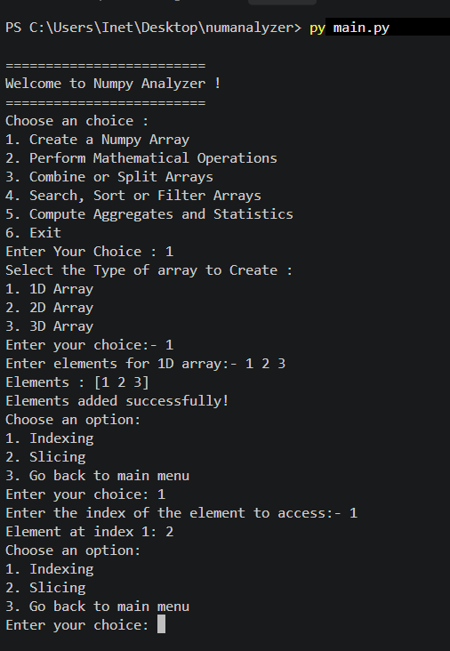

# NumPy Analyzer

> **A menu-driven Python CLI project for creating and analyzing 1D, 2D, and 3D NumPy arrays.**

## Description

NumPy Analyzer is a beginner-friendly, command-line program built with Python and NumPy. It lets you create an integer array and then choose operations from an interactive menu. You can inspect array elements, slice arrays, perform arithmetic, combine or split arrays, search and filter values, sort data, and calculate basic statistics.

## Features

- Create 1D, 2D, and 3D integer arrays
- Index and slice arrays
- Add, subtract, multiply, and divide arrays of the same shape
- Combine arrays with a vertical stack or split an array
- Search for values, sort arrays, and filter by a threshold
- Calculate sum, mean, and median

## Requirements

- Python 3.x.x  
- NumPy
- VS Code Python extension (recommended)

## Install Python and NumPy

1. Install Python 3.x or later for your operating system. On Windows, enable **Add Python to PATH** during installation if that option appears.
2. Open PowerShell or the VS Code integrated terminal and verify Python is available:

   ```powershell
   py --version
   ```

   If the `py` command is unavailable, try `python --version`.

3. Open the project folder in VS Code and open **Terminal → New Terminal**.
4. (Optional) Create and activate a virtual environment in PowerShell:

   ```powershell
   py -m venv .venv
   .\.venv\Scripts\Activate.ps1
   ```

5. Install NumPy:

   ```powershell
   py -m pip install numpy
   ```

## How to Run

1. Save the program as `main.py` in your project folder.
2. In VS Code, open **Terminal → New Terminal**.
3. Run:

   ```powershell
   py main.py
   ```

   If `py` is unavailable, use:

   ```powershell

   python main.py

   ```

4. Choose a menu option by entering its number. Create an array before selecting operations that use the current array. For 2D and 3D arrays, enter exactly the number of integer elements requested by the program.

## Project Structure

```text
 
├── main.py
├── output.png      
└── README.md   

```

## Sample Output

```text
=========================
Welcome to Numpy Analyzer !
=========================
Choose an choice :
1. Create a Numpy Array
2. Perform Mathematical Operations
3. Combine or Split Arrays
4. Search, Sort or Filter Arrays
5. Compute Aggregates and Statistics
6. Exit

Enter Your Choice : 5

Choose an option:
1. Sum
2. Mean
3. Median
Enter your choice: 1
Sum of all elements: 48

```

## Output



## Notes

- Array indices are zero-based, following NumPy conventions. For shape `(3, 2, 2)`, valid indices are depth `0–2`, row `0–1`, and column `0–1`.
- When dividing, a zero in the second array can produce `nan` and a NumPy runtime warning.
- Operations that combine arrays expect the second array to have the same number of elements and shape as the current array.

## Author

**VATSAL SOLANKI**  
 

 